 

  <!-- ═══════════════════════════════════════════════ -->
  <!--                 HERO EXPERIENCE                -->
  <!-- ═══════════════════════════════════════════════ -->

  

   

  <!-- ANIMATED IDENTITY -->

  

   

  
  &nbsp;
  
  &nbsp;
  

   
   

  <!-- PRIMARY NAVIGATION -->

  
  &nbsp;
  
  &nbsp;
  

   
   

  <!-- PERSONAL MANIFESTO -->

  <h2>Ideas are everywhere. Execution is the difference.</h2>

  

    I engineer digital experiences where
    <strong>thoughtful design</strong>,
    <strong>solid engineering</strong>, and
    <strong>useful technology</strong>
    come together.
  

   

  <!-- VISUAL SEPARATOR -->

  

   

  
    <code>INITIALIZING IDEAS</code>
    &nbsp; ◈ &nbsp;
    <code>ENGINEERING SOLUTIONS</code>
    &nbsp; ◈ &nbsp;
    <code>SHIPPING IMPACT</code>
  

---

## `01 / ORIGIN`

Hey, I'm **Bharat Poojari** — a BCA graduate and full-stack developer from **Sirsi, Karnataka, India**.

I enjoy turning ideas into useful digital products: from responsive web experiences and backend workflows to desktop tools and AI-assisted applications. I care about the details that make software feel complete — clear interfaces, maintainable structure, and a smooth path from the first click to the final task.

- **Building:** practical web applications, developer tools, and AI-powered experiences.
- **Interested in:** full-stack engineering, AI integration, interface design, and useful automation.
- **Approach:** understand the problem → design the flow → build → refine → ship.
- **Currently exploring:** better ways to connect thoughtful UX with useful engineering.

  

## `02 / SELECTED WORK`

A few projects that represent the kind of things I like to build.

<table>
  <tr>
    <td width="50%" valign="top">
      <h3>◈ OffyAI</h3>
      
<strong>Local-first AI desktop app for Windows</strong>

      
An exploration of running AI locally, with an emphasis on a desktop-first experience and local model workflows.

      

        <a href="https://offyai.vercel.app/">Product site ↗</a> ·
        <a href="https://github.com/bharat-poojari/offyai">Source code ↗</a>
      

      DESKTOP · LOCAL AI · WINDOWS
    </td>
    <td width="50%" valign="top">
      <h3>◈ Furniqo</h3>
      
<strong>3D furniture commerce experience</strong>

      
A furniture e-commerce concept focused on immersive 3D product visualization, responsive shopping flows, and polished interactions.

      
<a href="https://github.com/bharat-poojari/Furniqo">Explore source ↗</a>

      REACT · THREE.JS · 3D WEB
    </td>
  </tr>
  <tr>
    <td width="50%" valign="top">
      <h3>◈ CodePolish</h3>
      
<strong>A VS Code extension for cleaner code</strong>

      
A lightweight developer tool for beautifying or minifying HTML, CSS, and JavaScript from the editor.

      
<a href="https://github.com/bharat-poojari/codepolish">Explore source ↗</a>

      VS CODE · JAVASCRIPT · DEVELOPER TOOLING
    </td>
    <td width="50%" valign="top">
      <h3>◈ More experiments</h3>
      
I also explore web applications, backend workflows, and practical tools. Browse the repositories for the latest source and experiments.

      
<a href="https://github.com/bharat-poojari?tab=repositories">Browse all repositories ↗</a>

      LEARN · BUILD · ITERATE
    </td>
  </tr>
</table>

  <a href="https://bharat-poojari.vercel.app/"><strong>EXPLORE THE PORTFOLIO →</strong></a>

## `03 / TOOLKIT`

I choose tools based on the problem and the product being built.

  

| Focus | Tools and technologies |
|---|---|
| **Frontend** | HTML, CSS, JavaScript, React |
| **Backend & data** | PHP, Node.js, MySQL, REST API workflows |
| **AI & desktop** | Local-first AI exploration, desktop application workflows |
| **3D web** | Three.js and React-based 3D experiences |
| **Developer tooling** | TypeScript, VS Code extension development |
| **Workflow** | Git, GitHub, VS Code |

*This is a working toolkit, not a ranking of proficiency. The exact stack varies by project.*

## `04 / HOW I THINK ABOUT SYSTEMS`

```mermaid
flowchart LR
    A["Understand the problem"] --> B["Design the experience"]
    B --> C["Build the interface"]
    C --> D["Connect logic and data"]
    D --> E["Test and refine"]
    E --> F["Ship something useful"]
    style A fill:#101827,stroke:#8be9fd,color:#f8fafc
    style B fill:#101827,stroke:#8be9fd,color:#f8fafc
    style C fill:#101827,stroke:#8be9fd,color:#f8fafc
    style D fill:#101827,stroke:#bd93f9,color:#f8fafc
    style E fill:#101827,stroke:#bd93f9,color:#f8fafc
    style F fill:#101827,stroke:#50fa7b,color:#f8fafc
```

My goal is to connect the whole experience — not just make a screen look good, but make the underlying workflow understandable, useful, and maintainable.

## `05 / GITHUB SIGNAL`

  
  

  

Stats are provided by third-party services and may be cached, unavailable, or calculated differently from GitHub. Language cards describe repository code, not skill level.

## `06 / BEYOND THE CODE`

| EDUCATION | BASE | MINDSET |
|:---:|:---:|:---:|
| **Bachelor of Computer Applications** | **Sirsi, Karnataka, India** | **Build → Learn → Refine** |

I believe good software lives where **usefulness, engineering, and experience** meet. I'm interested in projects that solve real problems, make complex workflows feel simple, and give people a reason to come back.

## `07 / OPEN CHANNEL`

Have an idea, collaboration, project opportunity, or just want to talk about technology?

  
  

  

  BUILD WITH CURIOSITY · SHIP WITH INTENTION

   

  <a href="https://github.com/bharat-poojari">Back to the source ↗</a>

