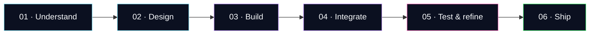

 

  <!-- ═══════════════════════════════════════════════ -->
  <!--                 HERO EXPERIENCE                -->
  <!-- ═══════════════════════════════════════════════ -->

  

   

  <!-- ANIMATED IDENTITY -->

  

   

  
  &nbsp;
  
  &nbsp;
  

   
   

  <!-- PRIMARY NAVIGATION -->

  
  &nbsp;
  
  &nbsp;
  

   
   

  <!-- PERSONAL MANIFESTO -->

  <h2>Ideas are everywhere. Execution is the difference.</h2>

  

    I engineer digital experiences where
    <strong>thoughtful design</strong>,
    <strong>solid engineering</strong>, and
    <strong>useful technology</strong>
    come together.
  

   

  <!-- VISUAL SEPARATOR -->

  

   

  
    <code>INITIALIZING IDEAS</code>
    &nbsp; ◈ &nbsp;
    <code>ENGINEERING SOLUTIONS</code>
    &nbsp; ◈ &nbsp;
    <code>SHIPPING IMPACT</code>
  

## `01 / ORIGIN`

Hey, I'm **Bharat Poojari** — a BCA graduate and full-stack developer from **Sirsi, Karnataka, India**.

I turn ideas into practical digital products: responsive web experiences, backend workflows, desktop tools, and AI-assisted applications. My focus is on the complete experience — clear interfaces, maintainable code, and workflows that make sense from the first click to the final task.

- **Building:** practical web applications, developer tools, and AI-powered experiences.
- **Interested in:** full-stack engineering, AI integration, interface design, and useful automation.
- **Approach:** understand the problem → design the flow → build → test → refine → ship.
- **Exploring:** better ways to connect thoughtful UX with useful engineering.

## `02 / SELECTED WORK`

> A selection of projects exploring different parts of the software stack.

<table>
  <tr>
    <td width="50%" valign="top">
      <h3>◈ OffyAI</h3>
      <strong>Local-first AI desktop app for Windows</strong>
      
Exploring local AI workflows through a desktop-first experience, with an emphasis on local model workflows.

      <a href="https://offyai.vercel.app/">↗ Product site</a> · <a href="https://github.com/bharat-poojari/offyai">↗ Source code</a>
        
      
      
    </td>
    <td width="50%" valign="top">
      <h3>◈ Furniqo</h3>
      <strong>3D furniture commerce experience</strong>
      
An e-commerce concept centered on immersive 3D product visualization, responsive shopping flows, and polished interactions.

      <a href="https://github.com/bharat-poojari/Furniqo">↗ Explore source</a>
        
      
      
    </td>
  </tr>
  <tr>
    <td width="50%" valign="top">
      <h3>◈ CodePolish</h3>
      <strong>A VS Code extension for cleaner code</strong>
      
A lightweight editor tool for beautifying or minifying HTML, CSS, and JavaScript without leaving the development workflow.

      <a href="https://github.com/bharat-poojari/codepolish">↗ Explore source</a>
        
      
      
    </td>
    <td width="50%" valign="top">
      <h3>◈ More experiments</h3>
      <strong>Small tools. New ideas. Continuous iteration.</strong>
      
I also explore web applications, backend workflows, and practical utilities. Browse the repositories to see current experiments.

      <a href="https://github.com/bharat-poojari?tab=repositories">↗ Browse all repositories</a>
        
      
      
    </td>
  </tr>
</table>

<a href="https://bharat-poojari.vercel.app/"><strong>EXPLORE THE PORTFOLIO →</strong></a>

## `03 / TOOLKIT`

  

| Domain | Tools and technologies |
|:--|:--|
| **Frontend** | HTML, CSS, JavaScript, React |
| **Backend & data** | Node.js, PHP, MySQL, REST API workflows |
| **AI & desktop** | Local-first AI exploration, desktop application workflows |
| **3D web** | Three.js and React-based 3D experiences |
| **Developer tooling** | TypeScript, VS Code extension development |
| **Workflow** | Git, GitHub, VS Code |

This is a working toolkit, not a ranking of proficiency. The exact stack varies by project.

## `04 / BUILD PIPELINE`

I aim to connect the whole experience — not just make a screen look good, but make the underlying workflow understandable, useful, and maintainable.

## `05 / GITHUB TELEMETRY`

  
  

  

  

Stats are rendered by third-party services and may be cached, unavailable, or calculated differently from GitHub. Language cards describe repository code, not skill level. The profile visit counter is a third-party estimate.

## `06 / BEYOND THE CODE`

| EDUCATION | BASE | MINDSET |
|:---:|:---:|:---:|
| **Bachelor of Computer Applications** | **Sirsi, Karnataka, India** | **Build → Learn → Refine** |

I believe good software lives where **usefulness, engineering, and experience** meet. I'm interested in projects that solve real problems, make complex workflows feel simple, and give people a reason to come back.

## `07 / OPEN CHANNEL`

Have an idea, collaboration, project opportunity, or want to discuss technology? Get in touch.

BUILD WITH CURIOSITY · SHIP WITH INTENTION

 

<a href="https://github.com/bharat-poojari">BACK TO THE SOURCE ↗</a>

